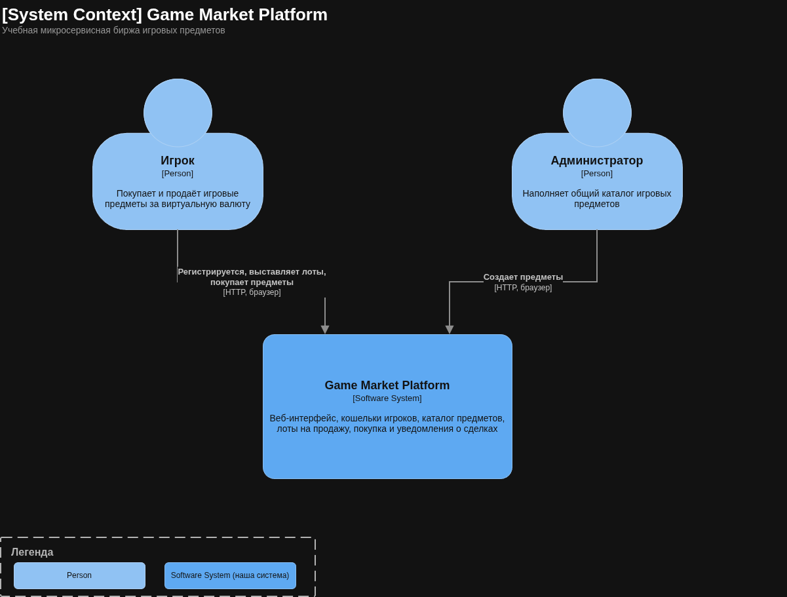
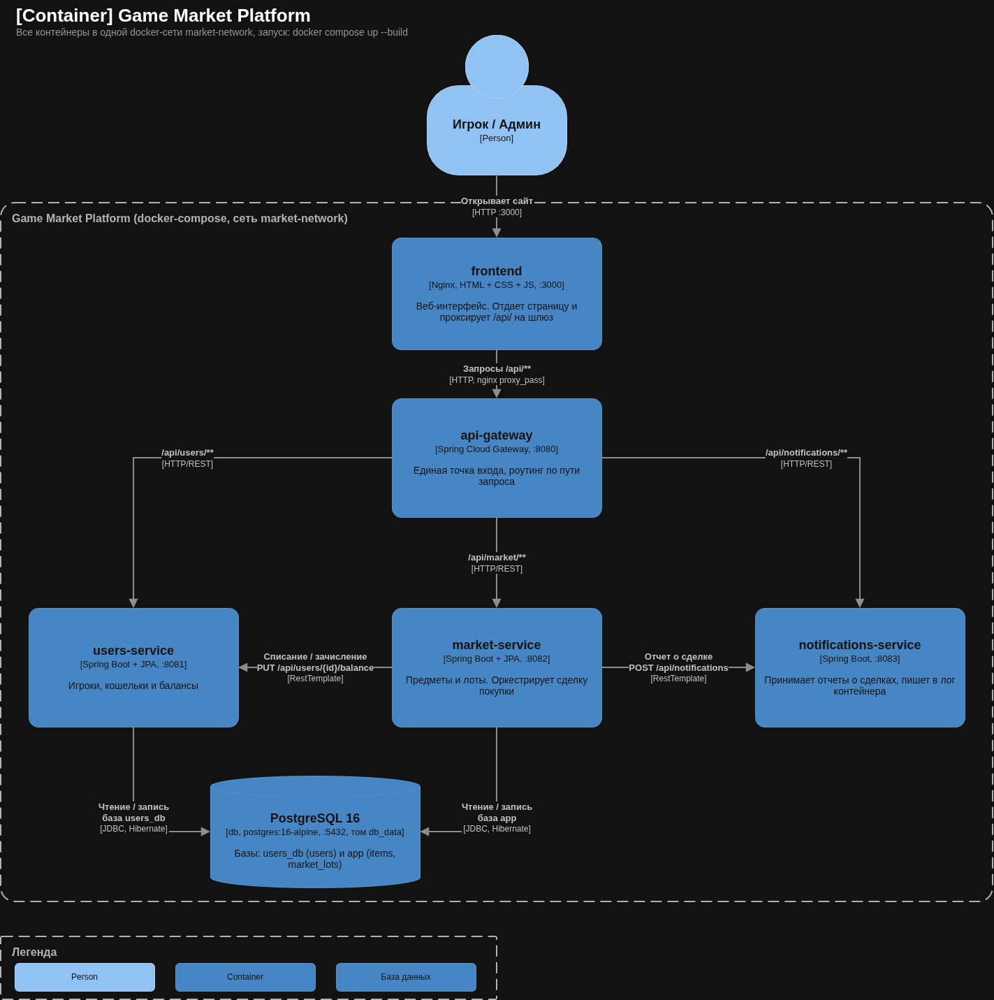
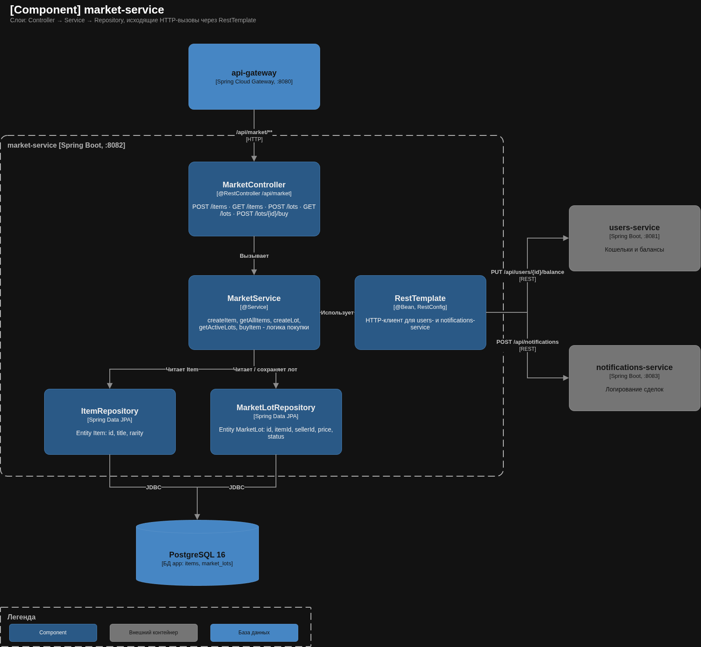

# Game Market Platform - Микросервисная платформа игровой биржи

Учебный проект: микросервисная торговая площадка (внутриигровой аукцион), на которой игроки обмениваются игровыми предметами за виртуальную валюту. Проект запускается одной командой через Docker Compose и имеет веб-интерфейс.

## Какую задачу решает система

Игрок регистрируется, получает кошелек, выставляет предметы на продажу и покупает предметы других игроков. При покупке система переводит деньги между кошельками, закрывает лот и отправляет уведомление о сделке.

## Технологический стек

* **Язык:** Java 21 (LTS)
* **Каркас:** Spring Boot 3.5.7, Spring Data JPA (Hibernate), Spring Cloud Gateway
* **Сборка:** Apache Maven (мультимодульный проект)
* **База данных:** PostgreSQL 16 (Alpine-образ), две базы в одном контейнере: `app` (market-service) и `users_db` (users-service)
* **Фронтенд:** HTML + CSS + JavaScript, раздается через Nginx
* **Развертывание:** Docker, Docker Compose, Alpine Linux JRE

## Архитектура

Система состоит из 6 контейнеров в одной docker-сети `market-network`: фронтенд, шлюз, три микросервиса и база данных.

### Схема C4

**Уровень 1. Контекст** - кто и зачем пользуется системой



**Уровень 2. Контейнеры** - из чего состоит система



**Уровень 3. Компоненты market-service** - как устроен центральный сервис



Исходник схем для draw.io: `docs/game-market-platform-c4.drawio`.

### Сервисы

| Контейнер | Порт | Ответственность |
|---|---|---|
| **frontend** (Nginx) | 3000 | Веб-интерфейс. Отдает страницу и проксирует запросы `/api/` на шлюз |
| **api-gateway** (Spring Cloud Gateway) | 8080 | Единая точка входа, роутинг запросов по пути: `/api/users/**`, `/api/market/**`, `/api/notifications/**` |
| **users-service** (Spring Boot + JPA) | 8081 | Игроки, кошельки и балансы. Хранит данные в PostgreSQL (база `users_db`) |
| **market-service** (Spring Boot + JPA) | 8082 | Каталог предметов, лоты, логика покупки. Хранит данные в PostgreSQL (база `app`) |
| **notifications-service** (Spring Boot) | 8083 | Принимает отчеты о сделках и выводит их в лог контейнера |
| **db** (PostgreSQL 16) | 5432 | Хранилище данных обоих сервисов |

### Как сервисы взаимодействуют

Все обращения идут по HTTP (REST, JSON).

1. Браузер открывает `frontend` (порт 3000), все запросы к API фронтенд передает на `api-gateway`.
2. Шлюз по пути запроса направляет его в нужный сервис.
3. При покупке `market-service` по HTTP (RestTemplate):
   * списывает деньги у покупателя: `PUT /api/users/{id}/balance` в `users-service`;
   * зачисляет деньги продавцу: тот же метод с положительной суммой;
   * меняет статус лота на `SOLD` в своей базе;
   * отправляет отчет о сделке: `POST /api/notifications` в `notifications-service`. Если сервис уведомлений недоступен, сделка все равно завершается.

### Хранение данных

* `market-service` и `users-service` подключаются к PostgreSQL через Spring Data JPA, таблицы создаются автоматически при старте (`ddl-auto: update`): `items` и `market_lots` в базе `app`, `users` в базе `users_db`.
* База `users_db` создается скриптом `db-init/01-users-db.sql`, который выполняется при первой инициализации контейнера `db`.
* Данные хранятся в именованном томе `db_data` (`/var/lib/postgresql/data`) и сохраняются между перезапусками контейнеров.
* Сервисы подключаются к базе по имени `db` внутри docker-сети. Контейнеры `users-service` и `market-service` стартуют только после того, как `db` пройдет healthcheck.

## Структура репозитория

```
game-market-platform/
├── api-gateway/              # шлюз, Dockerfile
├── users-service/            # сервис игроков, Dockerfile
├── market-service/           # сервис предметов и лотов, Dockerfile
├── notifications-service/    # сервис уведомлений, Dockerfile
├── frontend/                 # index.html, style.css, app.js, nginx.conf, Dockerfile
├── db-init/                  # скрипт создания базы users_db
├── docs/                     # схемы C4
├── docker-compose.yml
├── .env.example              # шаблон переменных окружения
└── pom.xml                   # родительский Maven-проект
```

## Инструкция по запуску

### Предварительные требования

* Установлены `maven`, JDK 21 или новее, `docker` и `docker compose`
* Свободны порты 3000, 5432, 8080, 8081, 8082, 8083

### Шаг 1. Настройка переменных окружения

Пароль базы данных не хранится в репозитории, он задается в файле `.env`:

```bash
cp .env.example .env
```

Откройте `.env` и впишите свой пароль:

```env
DB_NAME=app
DB_USER=postgres
DB_PASSWORD=ваш_пароль
```

### Шаг 2. Сборка проекта

В корневой директории проекта:

```bash
mvn clean package -DskipTests
```

### Шаг 3. Запуск в Docker Compose

```bash
docker compose up --build
```

После старта доступны:

* **Веб-интерфейс:** http://localhost:3000
* **API через шлюз:** http://localhost:8080/api/market/lots

Остановка: `docker compose down` (данные сохраняются). Остановка с удалением данных: `docker compose down -v`.

## Проверка результата

### Сценарий через веб-интерфейс

Откройте http://localhost:3000 и выполните:

1. Создайте игрока `Guts` с балансом 5000, затем игрока `Shadowheart` с балансом 100.
2. Создайте предмет `Шлем Саревока` (редкость Legendary).
3. Выберите игрока `Shadowheart` и выставьте предмет как лот за 1500.
4. Выберите игрока `Guts` и нажмите «Купить» у лота.

Ожидаемый результат:

* появляется плашка «Покупка выполнена», лот исчезает из списка активных;
* баланс `Guts` уменьшается до 3500, баланс `Shadowheart` увеличивается до 1600;
* в логах `docker compose logs notifications-service` появляется строка `[УВЕДОМЛЕНИЕ СО СДЕЛКИ]: Игрок ID 1 успешно купил 'Шлем Саревока' за 1500 монет у игрока ID 2.`

### Проверка сохранения данных

```bash
docker compose down
docker compose up
```

После перезапуска (без флага `-v`) игроки, предметы и лоты остаются на месте, так как лежат в томе `db_data`.

### Проверка API напрямую (Bruno, Postman, curl)

Все запросы отправляются на порт шлюза 8080.

**1. Создание игрока** - `POST http://localhost:8080/api/users`

```json
{ "username": "Guts", "balance": 5000 }
```

**2. Создание игрока-продавца** - `POST http://localhost:8080/api/users`

```json
{ "username": "Shadowheart", "balance": 100 }
```

**3. Создание предмета** - `POST http://localhost:8080/api/market/items`

```json
{ "title": "Шлем Саревока", "rarity": "Legendary" }
```

**4. Выставление лота** - `POST http://localhost:8080/api/market/lots`

```json
{ "itemId": 1, "sellerId": 2, "price": 1500 }
```

**5. Покупка** - `POST http://localhost:8080/api/market/lots/1/buy`

```json
{ "buyerId": 1 }
```

**Проверка:**

* `GET http://localhost:8080/api/users/1` - баланс `3500`
* `GET http://localhost:8080/api/users/2` - баланс `1600`
* `GET http://localhost:8080/api/market/lots` - список активных лотов (проданный лот в нем отсутствует)
* `GET http://localhost:8080/api/market/items` - список предметов каталога

## Безопасность и известные ограничения

* Пароль БД вынесен в `.env`, файл добавлен в `.gitignore`, в репозитории лежит только шаблон `.env.example`.
* В интерфейсе данные выводятся через `textContent`, что защищает от XSS.
* Аутентификации нет: игрок выбирается по ID. Это учебное упрощение.
* Покупка не атомарна: если зачисление продавцу не удастся после списания у покупателя, автоматического отката нет. Возможное развитие: компенсирующая операция или паттерн Saga.